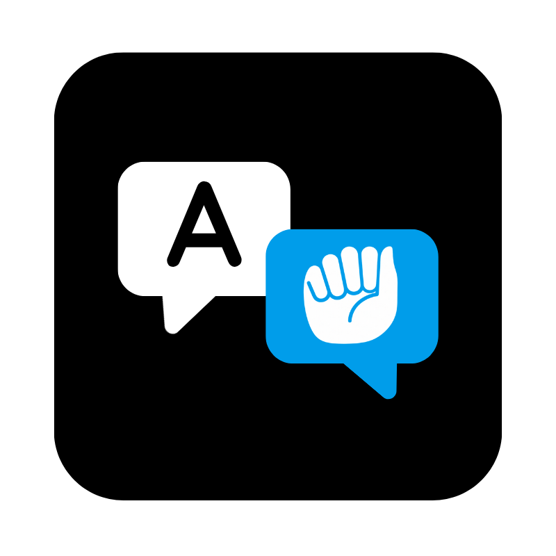
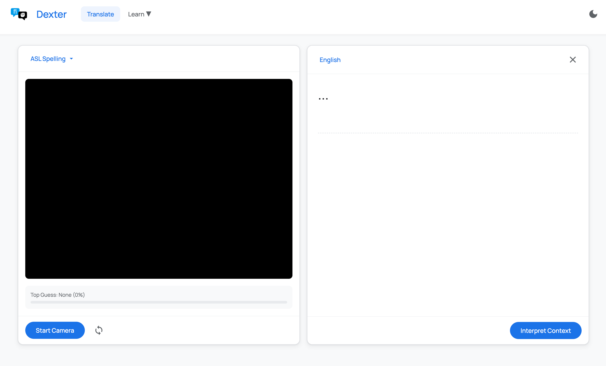

<div align="center">


<h1><a href="dexter-signs.vercel.app" target="_blank">Dexter</a></h1>



A real-time sign language translation tool for ASL Fingerspelling.
CSL Words and ASL Words are a work in progress.

</div>

---

## Features

- Real-Time ASL Fingerspelling translation
- Gemma 4-Powered Gloss Translation
- Built in ASL & CSL Dictionary

## How It Works

- Mediapipe extracts landmarks of your hand from the camera.
- The landmarks are processed by a Tensorflow.js model and Rule-based checks.
- The translated sign is outputed based on the coordinates of each landmark.
- The sign gloss is turned into a proper English sentence using the Gemma 4 API.

## Quick Start

[Click here to try out Dexter!](dexter-signs.vercel.app)

## Getting Started

```bash
git clone https://github.com/VITNT/dexter-prototype.git
cd dexter-prototype
```

Run the project on a local server.

Install the vercel CLI to test the Gemma 4 feature.
